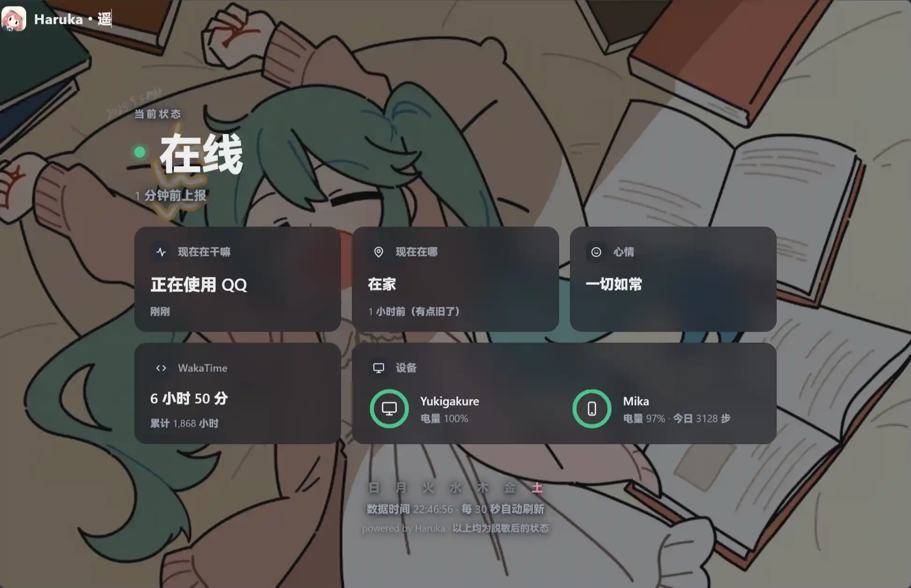

<div align="center">
  
  <h1>Haruka（遥）</h1>
  <i>A little lighthouse for your everyday presence.</i>
  <p>设备各在一方，让遥替你报个平安。</p>
</div>

<p align="center">
  <a href="#快速开始">🚀 快速开始</a> ·
  <a href="#隐私与控制">🔒 隐私与控制</a> ·
  <a href="#后续计划">🌱 后续计划</a> ·
  <a href="LICENSE">Apache-2.0</a>
</p>

## 简介✨

Haruka 是一个自托管的个人状态同步服务。她从你的常用设备采集在线状态、前台应用和项目别名，把经过本机脱敏的信息送到自己的服务器，再汇成一张公开状态页。

你可以用她给博客报个平安，也可以通过公开 API 为自己的站点制作组件。状态页内置灯塔插画、亮暗主题和移动端布局，每 30 秒自动更新。



**当前为开发预览版：Windows 桌面端已实现，Android 尚未实现。** Linux 桌面端适配已取消，采集端在该平台只上报心跳在线。功能与验证范围见下表；请先在本机试用，再配置公网部署。

## 特性🪄

- **多设备聚合**：独立心跳判断在线；有空闲检测时区分活跃与离开。
- **本机脱敏**：窗口标题只在设备上解析。项目名只显示你填写的公开别名，未知项目默认隐藏。
- **私密应用**：命中规则的银行、密码管理器等应用仅显示「私密应用」。
- **可选位置**：用部署者提供的离线 IP 数据库解析到市、省或国家；支持关闭定位。当前无法可靠提供区级位置。
- **暂停与隐身**：暂停单台设备采集；全局隐身立即撤下服务端公开状态。
- **断线补报**：观测缓存到本机 SQLite，重连后先发新状态，再补历史。历史补报不会冒充当前状态。
- **自托管**：Go 服务端、SQLite 数据库、内置静态页面，无需前端构建工具。

## 平台支持🌙

| 平台 | 已实现 | 目前的边界 |
| --- | --- | --- |
| Windows amd64 | 用户会话空闲检测、前台应用、IDE 别名；SCM 监督服务 | 默认活动控制台会话；服务绑定安装用户。安装加固、升级和切换用户流程需进一步真机复验；RDP 未验证 |
| Linux 桌面 | 已取消适配：采集端可构建运行，仅上报心跳在线 | 空闲检测、前台应用采集和服务安装不再实现。Linux 仍是服务端的推荐部署平台 |
| Android | 开发预览：心跳、手动状态、定位（离线反解 / 在家模式）、保活引导 | 自签 APK，GitHub Releases 分发；澎湃 OS 4 真机长期观测进行中；activity 采集未实现 |
| macOS / 手表 | 暂未支持 | macOS 仅检查构建；心率、步数和压力值暂未接入 |

## 快速开始🚀

需要 Git，以及 `go.mod` 指定的 Go 1.26.10 或更新的兼容工具链。当前从源码构建。

### 1. 构建

获取项目源码后，在仓库目录运行：

**Windows（本机试用，PowerShell，构建服务端与采集端）：**

```powershell
$env:GOARCH = "amd64"
go mod download
go build -trimpath -o bin/haruka-server.exe ./cmd/haruka-server
go build -trimpath -o bin/haruka-agent.exe ./cmd/haruka-agent
Copy-Item examples/haruka-server.example.yml haruka-server.yml
Copy-Item examples/haruka-agent.example.yml haruka-agent.yml
```

**Linux（服务端部署）：**

```sh
go mod download
go build -trimpath -o bin/haruka-server ./cmd/haruka-server
cp examples/haruka-server.example.yml haruka-server.yml
chmod 600 haruka-server.yml
```

下面使用 Linux 命令；Windows 将 `./bin/haruka-server`、`./bin/haruka-agent` 替换为对应的 `.exe`。

### 2. 登记设备

```sh
./bin/haruka-server device add -c haruka-server.yml \
  --name my-desktop --kind desktop --interval 60s --location-policy off
```

令牌只显示一次。把返回的 `id` 和 `token` 填入 `haruka-agent.yml`。每台设备单独登记，登记的 `--interval` 应与采集端的 `heartbeat_interval` 一致。

默认示例连接本机服务，定位关闭。首次试用可保留这些设置。要展示项目，请在 `activity.aliases` 中填写：

```yaml
activity:
  aliases:
    "vscode:my-project": "极光"
    "jetbrains:my-project": "极光"
  unmapped: hidden
```

键中的 `my-project` 是 IDE 默认窗口标题里的项目或目录名。值「极光」才是可公开的别名。自定义标题或无法识别的标题可能只显示应用名。

### 3. 启动并查看

在一个终端启动服务端：

```sh
./bin/haruka-server serve -c haruka-server.yml
```

在已登录的图形桌面中，用另一个终端启动采集端：

```sh
./bin/haruka-agent run --config haruka-agent.yml
```

打开 <http://127.0.0.1:8080/status>。也可以直接读取 <http://127.0.0.1:8080/v1/public/status>。首次更新需要等待采集和上报周期。

```sh
./bin/haruka-agent doctor --config haruka-agent.yml
./bin/haruka-agent status
```

`doctor` 展示服务连通性和采集能力。没有可用空闲协议时，在线状态不会冒充「正在操作」。

### 4. 设置自动运行

先确认前台运行正常，再安装桌面服务。保留二进制和配置的位置，避免移动后服务无法启动。

**Windows（PowerShell）：**

```powershell
$agentConfig = (Resolve-Path ./haruka-agent.yml).Path
./bin/haruka-agent.exe install --config $agentConfig
# 卸载
./bin/haruka-agent.exe uninstall
```

安装会申请 UAC 提权，并复制二进制到受保护的 Program Files 目录。监督服务只在安装用户的活动控制台会话中启动采集器。监督日志位于 Windows 应用程序事件日志，采集日志位于用户状态目录。服务升级后请重新安装。

## 隐私与控制🔒

暂停单台设备并清空其待报队列：

```sh
./bin/haruka-agent pause 2h
./bin/haruka-agent resume
```

自定义 `--state-dir` 时，`run`、`pause`、`resume` 和 `status` 必须使用同一目录。暂停在采集和上报的下一轮检查中生效；已有公开观测会按有效期撤下。需要立即全局隐藏时，在服务端运行：

```sh
./bin/haruka-server hide -c haruka-server.yml 2h
./bin/haruka-server show -c haruka-server.yml
```

省略时长可不限期隐身。默认 `on_hide: discard` 丢弃隐身期间事件。恢复后，边界之前的积压不会填回公开状态。在线页面在下一轮轮询时撤下展示；公开内容仍可能被访问者保存。

其他常用管理命令：

```sh
./bin/haruka-server device list -c haruka-server.yml
./bin/haruka-server device revoke -c haruka-server.yml --id <设备ID>
./bin/haruka-server backup -c haruka-server.yml -o backup.db
./bin/haruka-server owner-token -c haruka-server.yml --generate
```

备份包含历史状态和令牌哈希，需要私密保存。owner 令牌用于远程隐身控制和设备定位策略，不要放进博客或浏览器脚本。

窗口标题原文不进入上报事件，浏览器页面使用 `textContent` 渲染。私密清单和字符串校验不能识别所有个人信息；请检查你配置的别名、应用映射和手动文字。更完整的边界见 [安全说明](SECURITY.md)。

## 安装 Android 客户端📦

从 [GitHub Releases](https://github.com/Moemu/Haruka/releases) 下载 `Haruka-<版本>-android.apk` 安装。自签 APK 不经应用商店，安装时按 ROM 提示放行三层：

1. **未知来源**：给浏览器/文件管理器授「安装未知应用」权限（一次性）；
2. **Play Protect**：提示「未经过 Play 保护机制检查」时选择继续安装；
3. **澎湃 OS 纯净模式**：若被系统拦截，在 设置 → 更多安全设置 → 纯净模式 中关闭或允许本次安装。

签名证书 SHA-256 为 `daf61f2774b8a881331e47d298cf7f340f6f05d0b4c19e4d6cac96de2088c38b`，与 Release 附件 `cert-digest.txt` 核对一致即为官方包。注意：开发用 debug 签名与 release 签名互不兼容，不能互相覆盖升级；更换签名密钥意味着卸载重装。

## Android 后台运行（澎湃 OS）📢

Haruka 的 Android 端按「不触发系统管控」设计：不持唤醒锁、不做后台高耗电，单次心跳秒级完成，被误伤概率低。但澎湃 OS（以及其它国产 ROM）的省电策略仍可能限制它，表现为状态页长时间不更新。应用仪表盘会在明显超期未同步时提示；如果遇到，按下面三步检查（应用内「保活引导」页有同样内容）：

1. **忽略电池优化**：应用内可直接发起系统申请对话框；
2. **省电策略设为「无限制」**：设置 → 应用 → 应用管理 → 遥 → 省电策略；
3. **允许自启动**：手机管家 → 应用管理 → 权限 → 自启动。

若仍被限制：最近任务卡片长按 → 锁定；或在 设置 → 省电与电池 → 右上角 → 应用智能省电 中核查（Powerkeeper 管辖入口）。

如实承诺：Haruka 不会自动修改任何系统设置；Doze 深度休眠期间状态更新变慢属预期；不承诺对抗强制停止与系统的硬性后台限制。

## 部署与配置⚙️

服务端与采集端可以运行在不同机器。此时将采集端的 `server` 改为自己的 HTTPS 地址。服务端监听回环地址，由反向代理终止 TLS；请在代理层配置限流和连接数限制。应用目前没有内置限流。

`trusted_proxies` 只填写实际代理地址；`cors_origins` 只影响浏览器跨域读取，公开 API 本身没有访问鉴权。内置页面使用同源 API，无需 CORS 设置。

位置默认关闭。需要启用时，自行取得与当前 ip2region Go 绑定兼容的 `.xdb` 数据库，并遵守数据提供方许可：

| 模式 | 配置 | 行为 |
| --- | --- | --- |
| off | 采集端 `location.mode: off` | 服务端排除该设备的位置 |
| server | 采集端 `location.mode: server`；服务端 `location_lookup_db` 指向 xdb | 服务端解析连接 IP，派生粗略行政区名称 |
| local | 采集端 `location.mode: local`、`collectors.location: true` 和 `location.local_db` | 从自己的服务取得出口 IP，在设备本机解析后上报行政区名称 |

采集端会同步服务端定位策略。只有 local 策略确认成功后才发送本地位置事件。IP 定位可能显示代理或运营商所在地，无法保证区级准确度；当前 `override` 和 `home_district` 尚未实现，填写非空值会报错。

配置示例见 [服务端](examples/haruka-server.example.yml) 和 [采集端](examples/haruka-agent.example.yml)。配置修改后需重启。历史事件默认保留 7 天，过期位置可能继续作为旧观测展示，页面会标注时间。

## API📖

| 接口 | 权限 | 用途 |
| --- | --- | --- |
| `GET /status` | 公开 | 内置状态页 |
| `GET /v1/public/status` | 公开 | 脱敏聚合快照，支持 ETag |
| `GET /healthz` | 公开 | 存活检查 |
| `GET /v1/whoami-ip` | 公开 | 返回调用者出口 IP；不缓存 |
| `POST /v1/ingest` | 设备 Bearer 令牌 | 提交协议 v1 事件 |
| `POST /v1/device-capability` | 设备 Bearer 令牌 | 续报自身 presence 能力 |
| `POST /v1/device-policy` | 设备或 owner 令牌 | 修改自身或指定设备定位策略 |
| `POST /v1/control` | owner Bearer 令牌 | `hide` / `show` |

事件契约见 [JSON Schema](protocol/schema/envelope.schema.json) 和 [示例事件](protocol/fixtures/)。在线判定以心跳为准，观测以事件时间判定新鲜度。来源设备 active 时展示活动；明确 unsupported 且能力有效时使用「前台应用」中性描述；away、过期和普通采集故障仍隐藏。

手动心情事件已由服务端支持，但当前桌面 CLI 没有填写页面；面向用户的输入功能随 Android 应用开发。

## 后续计划🌱

- [ ] Android 应用：服务状态、暂停控制、手动心情，以及权限与后台运行说明。
- [ ] 自动构建发布包：服务端容器镜像与采集端二进制的发布流水线。
- [ ] 运维小件：缓存空间回收、日志轮转、内置限流和备份恢复。
- [ ] 真实出口 IP 的定位验证；区级位置与本机隐私降级，家庭位置保护和手动覆盖。
- [ ] 根据实际需要接入手表的心率、步数等可选指标。

服务端已在生产环境以容器方式部署（Docker + Caddy 反代）。Linux 桌面端适配已取消。Windows 的安装与升级流程随日常使用逐步完善，不再安排专项的桌面环境验证计划。

## 参与开发🤝

贡献方法和检查命令见 [CONTRIBUTING.md](CONTRIBUTING.md)。欢迎提供脱敏的复现步骤和真实桌面验证结果。报告漏洞请使用 [私密安全渠道](SECURITY.md)。

本仓库公开源码、测试、协议、配置示例和 CI。本机设计记录、Agent 计划、运行配置、数据库、日志、截图及构建产物留在本地。

## 鸣谢与许可🎗️

Haruka 按 [Apache-2.0](LICENSE) 提供，版权声明见 [NOTICE](NOTICE)。依赖的许可副本见 [第三方声明](THIRD_PARTY_NOTICES.md)；离线地理数据和外部字体不随仓库提供。

展示思路受到 [vereis.com](https://vereis.com/) 等个人状态页的启发。
